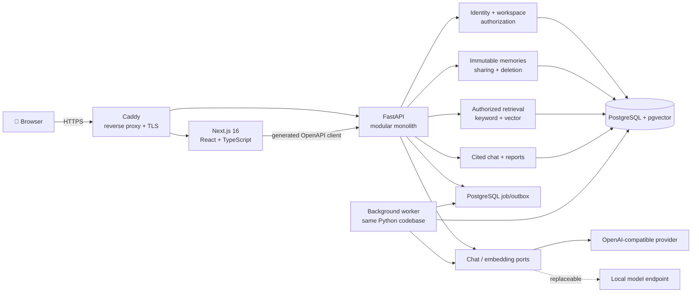

<div align="center">

## [🇬🇧 English](./README.md) · [🇨🇳 中文](./README_CN.md)

# 🧠 Memora

### Your ideas deserve a memory that can answer back.

Memora turns scattered thoughts into a private, permission-aware knowledge
network for people and small teams—then helps you retrieve, compare, and
understand them with evidence-backed AI.

[](https://github.com/qinyh10300/Memora/actions/workflows/ci.yml)


<p>
  <a href="#-quick-start"><strong>🚀 Quick Start</strong></a>
  ·
  <a href="docs/product/brief.md">🎯 Product Brief</a>
  ·
  <a href="docs/architecture/overview.md">🏗️ Architecture</a>
  ·
  <a href="docs/development.md">🛠️ Developer Guide</a>
</p>

</div>

> 🧪 **Project status:** the local v0.1 product is complete through milestone
> M6.1 and has passed offline checks, PostgreSQL/pgvector integration,
> full-container smoke tests, and desktop/mobile browser acceptance. Public
> deployment (M7) is intentionally pending infrastructure, production
> credentials, backup validation, and a dedicated low-budget AI key.

## ✨ Product at a glance

- ⚡ **Capture before enrichment** — a memory is saved before any AI job runs,
  so a provider failure never loses the original thought.
- 🔐 **Private by default** — every new memory starts private and becomes
  workspace-visible only after an explicit user action.
- 🔎 **Permission-aware retrieval** — keyword and vector search apply identity,
  workspace, author, visibility, and time filters before generation.
- 📎 **Evidence over fluency** — factual answers include the original memory,
  author, timestamp, excerpt, and a path back to the source.
- 🕰️ **Temporal integrity** — ideas are appended, supplemented, or superseded;
  history is never silently rewritten.
- 🤖 **Replaceable AI** — chat and embedding providers sit behind independent
  ports, while deterministic search, answers, and reports remain available
  without an external model.

## 💫 Why Memora?

Thoughts usually end up scattered across chats, documents, issue trackers, and
half-remembered conversations. Finding one old decision is tedious; seeing how
an opinion evolved is even harder. Team context adds a second problem: useful
knowledge should be shareable without turning every private note into common
property.

Memora treats memory as an evidence system rather than a pile of notes:

1. **Tell Memora what is on your mind.**
2. **Choose whether it stays private or is shared with the workspace.**
3. **Ask about an old idea, a teammate's shared progress, or a time period.**
4. **Inspect the citations instead of trusting a confident black box.**

If the available evidence is not enough, “I don't know” is a valid answer.

## 🪄 Conversation-first experience

The Web app intentionally presents one focused, dark conversational interface.
The interaction layer interprets user intent, but it never becomes the security
boundary.

| What the user does | What Memora guarantees |
| --- | --- |
| Writes a new thought | Asks “only me or share with the team?” before saving the visibility choice |
| Asks about the past | Defaults to personal scope unless a teammate or workspace is named explicitly |
| Requests a report | Requires an explicit, timezone-aware date range |
| Shares or unshares a memory | Revalidates later search results and invalidates stale cross-user citations |
| Deletes a memory | Requires confirmation, removes the body and embedding from active retrieval |
| Uses Memora without AI keys | Keeps capture, keyword search, deterministic cited answers, and structured reports working |

Low-frequency operations—share, unshare, supplement, and delete—can also be
expressed as conversational commands. The API still independently validates
identity, ownership, scope, time, and citation authorization.

## 🧭 Core flows

### Capture lifecycle

```text
conversation draft
  → explicit PRIVATE / WORKSPACE choice
  → authenticate and verify membership
  → write immutable memory + embedding job in one transaction
  → return success without waiting for AI
  → worker embeds asynchronously
  → retry, wait for configuration, or degrade to keyword search
```

### Authorized retrieval and generation

```text
authenticate
  → resolve workspace membership
  → resolve explicit scope and time range
  → build the authorized candidate set
  → hybrid keyword/vector retrieval
  → rerank authorized evidence
  → send the minimum necessary context to the model
  → generate answer and citations
  → authorize every citation again
  → persist answer, citations, and usage metadata
```

The ordering is deliberate: private content is filtered before retrieval and
generation, not hidden later by UI code or prompt instructions.

## 🤖 AI and retrieval design

Memora separates AI capabilities from product correctness:

- `ChatModelPort` normalizes chat generation, structured output, usage, timeout,
  and provider errors.
- `EmbeddingModelPort` handles batch embeddings, model identity, dimensions,
  and usage.
- PostgreSQL full-text/keyword search remains available when semantic search is
  disabled or degraded.
- pgvector results are isolated by embedding model and dimensions.
- factual chat answers and reports are grounded in an authorized evidence set;
  model prose never decides visibility.
- model input treats every memory body as untrusted data, reducing prompt
  injection risk.

The current adapter supports OpenAI-compatible HTTP endpoints. A future local
model can implement the same ports without changing the authorization or
retrieval rules.

## 🏗️ Technical architecture



Memora is a modular monolith, not a collection of premature microservices. The
API and worker share one backend codebase; PostgreSQL remains the single source
of truth; the deployment unit stays understandable on one Linux server.

## 📦 Repository structure

```text
Memora/
├── apps/
│   ├── web/                 # Next.js conversation UI and generated API client
│   └── api/                 # FastAPI API, worker, migrations, tests
├── packages/
│   └── api-contract/        # Generated OpenAPI JSON and TypeScript types
├── docs/
│   ├── product/             # Product baseline and validated scope
│   ├── architecture/        # System boundaries and data flows
│   ├── adr/                 # Accepted architecture decisions
│   └── plans/               # Active and completed execution plans
├── scripts/                 # Health waits, smoke tests, contract checks
├── deploy/
│   └── Caddyfile            # Same-origin routing and HTTPS
├── compose.yaml             # Web, API, worker, database, migration, proxy
├── Makefile                 # Stable developer command contract
├── AGENTS.md                # Repository rules for coding agents
└── PLANS.md                 # Execution-plan protocol
```

### Backend capability boundaries

| Module | Responsibility |
| --- | --- |
| `identity` | login, session lifecycle, password hashing, current user |
| `workspaces` | membership and workspace isolation |
| `memories` | append-only capture, supplements, sharing, deletion |
| `retrieval` | authorization filters, keyword/vector recall, reranking |
| `conversations` | chat context and explicit query scopes |
| `reports` | personal, colleague, and workspace evidence reports |
| `ai` | provider-independent chat and embedding ports/adapters |
| `jobs` | transactional outbox, leases, retries, processing states |

## 🔐 Privacy and security invariants

- New memories are always `PRIVATE`.
- Only the author can share, unshare, supplement, or delete a memory.
- A user may retrieve their own records plus records explicitly shared to their
  workspace—never another user's private records.
- Private search text is sent in POST JSON rather than URLs and access logs.
- Browser sessions use opaque server-side session records and secure cookies,
  not browser-stored JWTs.
- Production rejects placeholder session secrets and local seed passwords.
- Logs must not contain memory bodies, full prompts, cookies, passwords, API
  keys, or vectors.
- Removing access invalidates dependent cross-user citations; deletion removes
  active text and embeddings.
- Real secrets belong only in the ignored `.env`, never in Git or client-side
  `NEXT_PUBLIC_*` variables.

For the full threat and trust model, read
[`docs/architecture/overview.md`](docs/architecture/overview.md).

## 🚀 Quick start

### Requirements

- Node.js 22
- pnpm 11.9
- Python 3.13
- uv 0.11+
- Docker with Docker Compose
- make and curl

### Start the complete local product

```bash
make setup
make dev
```

In a second terminal:

```bash
./scripts/wait-for-services.sh
make e2e
```

Open [http://localhost:8080](http://localhost:8080). Local seed accounts and
development-only passwords are documented in
[`docs/development.md`](docs/development.md).

### Native hot reload

```bash
make db

# Run these in separate terminals:
make api-dev
make web-dev
```

## ✅ Engineering workflow

The repository exposes stable commands so maintainers, CI, and coding agents
exercise the same paths:

| Command | Purpose |
| --- | --- |
| `make setup` | install locked Web/Python dependencies and create local config |
| `make dev` | run the full Compose environment |
| `make format-check` | verify Prettier and Ruff formatting |
| `make lint` | run ESLint and Ruff |
| `make typecheck` | run TypeScript and strict MyPy |
| `make test` | run Vitest and Pytest |
| `make contract-check` | detect OpenAPI/generated-client drift |
| `make build` | build the production Next.js app |
| `make check` | run the complete offline quality gate |
| `make compose-check` | validate the Compose model |
| `make e2e` | exercise auth, privacy, search, chat, reports, sharing, and deletion |

`make check` runs without production AI credentials and must not contact an
external model.

## ⚙️ Configuration

Copy `.env.example` to `.env` through `make setup`. The example contains only
variable names and local placeholders.

Chat and embedding settings are independent:

- `AI_CHAT_BASE_URL`, `AI_CHAT_API_KEY`, `AI_CHAT_MODEL`
- `AI_EMBEDDING_BASE_URL`, `AI_EMBEDDING_API_KEY`,
  `AI_EMBEDDING_MODEL`

Production also requires unique database credentials, a strong session secret,
production seed accounts, a real `CADDY_SITE_ADDRESS`, and a reviewed backup
policy. See [`docs/development.md`](docs/development.md) before deployment.

## 🧪 Quality strategy

- Web unit and component tests cover the conversation state machine.
- API tests cover identity, memories, retrieval, chat, reports, AI adapters,
  and worker behavior.
- PostgreSQL/pgvector integration tests exercise positive and negative
  authorization paths.
- The generated OpenAPI client is checked for drift.
- Container smoke tests validate the same-origin Web/API path and degraded AI
  behavior.
- CI runs the offline quality gate first, then builds the full container stack
  and executes the end-to-end flow.

## 🗺️ Status and roadmap

- [x] Reproducible monorepo and unified developer commands
- [x] Seed identity, secure sessions, and workspace boundary
- [x] Private capture, explicit sharing, supplements, and deletion
- [x] Reliable embedding jobs and authorized hybrid retrieval
- [x] Cited chat with provider-degraded evidence mode
- [x] Personal, colleague, and workspace evidence reports
- [x] Conversation-first desktop and mobile experience
- [ ] Public HTTPS test deployment
- [ ] Backup/restore exercise and production smoke test
- [ ] Dedicated provider validation with a limited-budget key
- [ ] Two-week four-person product experiment

The active execution record lives in
[`docs/plans/active/0001-foundation-and-first-vertical-slice.md`](docs/plans/active/0001-foundation-and-first-vertical-slice.md).

## 🤝 Contributing

Issues and technical proposals are welcome. Before changing behavior:

1. read the [product brief](docs/product/brief.md), [architecture
   overview](docs/architecture/overview.md), accepted
   [ADR](docs/adr/0001-initial-system-architecture.md), and
   [agent guide](AGENTS.md);
2. preserve private-by-default capture, authorization-before-retrieval, and
   evidence-backed answers;
3. update the OpenAPI contract when an API changes;
4. add tests for behavior and permission boundaries;
5. run `make check` before opening a pull request.

## 🔗 Related project

[Memora Extension](https://github.com/qinyh10300/memora-extension) is a
standalone, local-first browser experiment for turning Web pages into reusable
knowledge cards. It is intentionally not part of the Memora v0.1 server scope.

## 📄 License

No open-source license has been declared yet. The source is public for
inspection and collaboration, but reuse rights should not be assumed until a
license is added.
