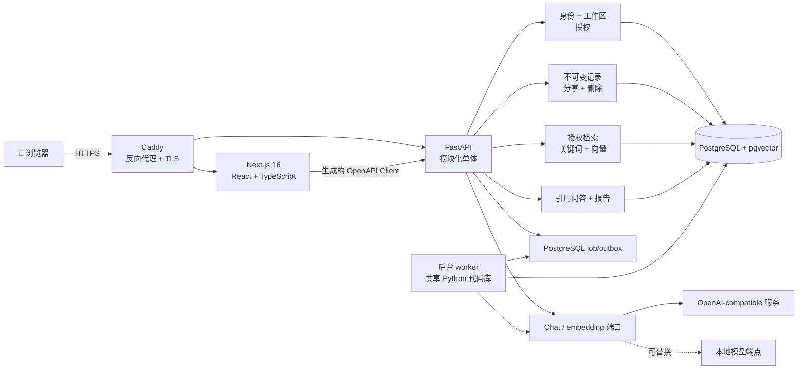

<div align="center">

## [🇬🇧 English](./README.md) · [🇨🇳 中文](./README_CN.md)

# 🧠 Memora

### 让你的想法不只被记住，还能带着证据回答你。

Memora 将散落的想法连接成一个面向个人与小团队、默认私有且尊重权限边界的知识网络，
再通过有来源引用的 AI，帮助你找回、比较和理解过去的思考。

[](https://github.com/qinyh10300/Memora/actions/workflows/ci.yml)


<p>
  <a href="#-快速开始"><strong>🚀 快速开始</strong></a>
  ·
  <a href="docs/product/brief.md">🎯 产品简报</a>
  ·
  <a href="docs/architecture/overview.md">🏗️ 系统架构</a>
  ·
  <a href="docs/development.md">🛠️ 开发指南</a>
</p>

</div>

> 🧪 **项目状态：** 本地 v0.1 已完成至 M6.1，并通过离线质量检查、
> PostgreSQL/pgvector 集成、完整容器 smoke test，以及桌面和移动端浏览器验收。
> 公网部署 M7 正在等待服务器、生产凭据、备份验证和专用低额度 AI Key。

## ✨ 产品亮点

- ⚡ **先记录，再增强** — memory 会先可靠保存，AI 任务失败也不会丢失原始想法。
- 🔐 **默认私有** — 每条新记录最初只属于作者，只有用户明确操作后才对工作区可见。
- 🔎 **权限感知检索** — 在生成回答之前，先按身份、工作区、作者、可见性和时间过滤。
- 📎 **证据优先于流畅** — 事实性回答附带原记录、作者、时间、摘录和来源入口。
- 🕰️ **尊重时间完整性** — 想法通过追加、补充和演进表达，不静默改写历史。
- 🤖 **可替换 AI** — Chat 与 embedding 使用独立端口；没有外部模型时，
  关键词检索、确定性引用回答和结构化报告仍然可用。

## 💫 为什么需要 Memora？

想法经常散落在聊天、文档、Issue 和模糊的记忆中。找到一个过去的判断很麻烦，
理解观点如何随时间变化更难。团队协作还有另一层挑战：共享上下文应该足够方便，
但不应让每条私人记录自动变成公共资产。

Memora 把记忆当作一套证据系统，而不是一堆无法追溯的笔记：

1. **把此刻的想法告诉 Memora。**
2. **选择仅自己可见，或主动分享给团队。**
3. **询问过去的想法、同事主动分享的进展，或某段时间的变化。**
4. **检查原始引用，而不是盲信一个语气自信的黑盒。**

当证据不足时，“我不知道”也是正确答案。

## 🪄 对话优先的产品体验

Web 端只呈现一个专注、暗黑风格的对话界面。交互层负责理解意图，但永远不承担真正的权限边界。

| 用户操作 | Memora 的保证 |
| --- | --- |
| 写下一个新想法 | 先追问“仅自己 / 分享团队”，再保存对应可见性 |
| 回顾过去 | 默认只查询个人记录，除非明确点名成员或团队 |
| 请求报告 | 必须提供明确且带时区的日期范围 |
| 分享或取消分享 | 后续检索重新授权，并让失效的跨用户引用不可再用 |
| 删除记录 | 二次确认，并从活动检索中移除正文与 embedding |
| 未配置 AI Key | 记录、关键词检索、确定性引用回答和结构化报告继续工作 |

分享、取消共享、补充和删除等低频操作也可以通过自然语言命令完成。
API 仍会独立校验身份、所有权、范围、时间和引用权限。

## 🧭 核心流程

### 记录生命周期

```text
对话草稿
  → 明确选择 PRIVATE / WORKSPACE
  → 验证身份与工作区成员关系
  → 在同一事务写入不可变 memory 与 embedding job
  → 不等待 AI，立即返回保存成功
  → worker 异步生成 embedding
  → 重试、等待配置，或降级为关键词检索
```

### 授权检索与生成

```text
身份认证
  → 解析工作区成员关系
  → 解析明确范围与时间
  → 构建有权限的候选集合
  → 关键词 / 向量混合检索
  → 在授权证据内重排
  → 向模型发送最小必要上下文
  → 生成回答与引用
  → 再次验证每条引用权限
  → 保存回答、引用和用量元数据
```

这个顺序非常重要：私有内容在检索和生成前就被过滤，而不是依赖 UI 隐藏或提示词约束。

## 🤖 AI 与检索设计

Memora 将 AI 能力与产品正确性分离：

- `ChatModelPort` 统一聊天生成、结构化输出、用量、超时和供应商错误。
- `EmbeddingModelPort` 处理批量 embedding、模型标识、维度和用量。
- 语义检索不可用或降级时，PostgreSQL 关键词检索仍可工作。
- pgvector 结果按 embedding 模型和维度隔离。
- Chat 与报告只使用经过授权的证据，模型文本不参与决定可见性。
- 模型输入把 memory 正文视作不可信数据，以降低提示注入风险。

当前 adapter 支持 OpenAI-compatible HTTP 接口。未来本地模型只需实现相同端口，
无需改变授权与检索规则。

## 🏗️ 技术架构



Memora 是模块化单体，而不是过早拆分的微服务集合。API 与 worker 共用后端代码，
PostgreSQL 是唯一事实来源，完整产品可以在一台 Linux 服务器上清晰部署和运维。

## 📦 仓库结构

```text
Memora/
├── apps/
│   ├── web/                 # Next.js 对话界面与生成的 API client
│   └── api/                 # FastAPI、worker、迁移和测试
├── packages/
│   └── api-contract/        # 生成的 OpenAPI JSON 与 TypeScript 类型
├── docs/
│   ├── product/             # 产品基线与已确认范围
│   ├── architecture/        # 系统边界和数据流
│   ├── adr/                 # 已接受的架构决策
│   └── plans/               # 活动与已完成的执行计划
├── scripts/                 # 健康等待、smoke test、契约检查
├── deploy/
│   └── Caddyfile            # 同源路由与 HTTPS
├── compose.yaml             # Web、API、worker、数据库、迁移和代理
├── Makefile                 # 稳定的开发命令契约
├── AGENTS.md                # Coding Agent 仓库规则
└── PLANS.md                 # 执行计划规范
```

### 后端能力边界

| 模块 | 职责 |
| --- | --- |
| `identity` | 登录、会话生命周期、密码哈希与当前用户 |
| `workspaces` | 成员关系与工作区隔离 |
| `memories` | 追加式记录、补充、分享与删除 |
| `retrieval` | 权限过滤、关键词/向量召回与重排 |
| `conversations` | 对话上下文与明确查询范围 |
| `reports` | 个人、同事与工作区证据报告 |
| `ai` | 与供应商无关的 Chat / embedding 端口及 adapter |
| `jobs` | 事务 outbox、租约、重试与处理状态 |

## 🔐 隐私与安全不变量

- 新记录始终为 `PRIVATE`。
- 只有作者可以分享、取消分享、补充或删除自己的记录。
- 用户只能检索自己的记录与工作区中主动共享的记录。
- 私有搜索内容使用 POST JSON，不进入 URL 和普通访问日志。
- 浏览器会话使用服务端不透明 session 与安全 Cookie，而不是存储在浏览器中的 JWT。
- 生产环境拒绝占位会话密钥和本地 seed 密码。
- 日志不得包含 memory 正文、完整提示词、Cookie、密码、API Key 或向量。
- 撤销访问会让相关跨用户引用失效；删除会移除活动正文和 embedding。
- 真实密钥只允许出现在已忽略的 `.env`，不能进入 Git 或 `NEXT_PUBLIC_*` 客户端变量。

完整威胁和信任模型见
[`docs/architecture/overview.md`](docs/architecture/overview.md)。

## 🚀 快速开始

### 环境要求

- Node.js 22
- pnpm 11.9
- Python 3.13
- uv 0.11+
- Docker 与 Docker Compose
- make 和 curl

### 启动完整本地产品

```bash
make setup
make dev
```

在另一个终端运行：

```bash
./scripts/wait-for-services.sh
make e2e
```

打开 [http://localhost:8080](http://localhost:8080)。本地 seed 账号和仅限开发环境的密码见
[`docs/development.md`](docs/development.md)。

### 原生热更新

```bash
make db

# 分别在两个终端运行：
make api-dev
make web-dev
```

## ✅ 工程工作流

仓库提供稳定命令，让维护者、CI 和 Coding Agent 运行相同的验证路径：

| 命令 | 用途 |
| --- | --- |
| `make setup` | 安装锁定的 Web/Python 依赖并创建本地配置 |
| `make dev` | 启动完整 Compose 环境 |
| `make format-check` | 检查 Prettier 与 Ruff 格式 |
| `make lint` | 运行 ESLint 与 Ruff |
| `make typecheck` | 运行 TypeScript 与严格 MyPy |
| `make test` | 运行 Vitest 与 Pytest |
| `make contract-check` | 检测 OpenAPI / 生成客户端漂移 |
| `make build` | 构建 Next.js 生产版本 |
| `make check` | 运行完整离线质量门禁 |
| `make compose-check` | 验证 Compose 配置 |
| `make e2e` | 验证身份、隐私、检索、Chat、报告、分享与删除 |

`make check` 不需要生产 AI 凭据，也不得调用外部模型。

## ⚙️ 配置

`make setup` 会根据 `.env.example` 创建 `.env`。示例文件只包含变量名称和本地占位值。

Chat 与 embedding 配置彼此独立：

- `AI_CHAT_BASE_URL`、`AI_CHAT_API_KEY`、`AI_CHAT_MODEL`
- `AI_EMBEDDING_BASE_URL`、`AI_EMBEDDING_API_KEY`、`AI_EMBEDDING_MODEL`

生产环境还需要独立数据库凭据、强会话密钥、生产 seed 账号、真实
`CADDY_SITE_ADDRESS` 和经过评审的备份策略。部署前请阅读
[`docs/development.md`](docs/development.md)。

## 🧪 质量策略

- Web 单元与组件测试覆盖对话状态机。
- API 测试覆盖身份、记录、检索、Chat、报告、AI adapter 和 worker。
- PostgreSQL/pgvector 集成测试覆盖权限正向与反向路径。
- 生成的 OpenAPI client 会进行漂移检查。
- 容器 smoke test 验证同源 Web/API 路径和 AI 降级行为。
- CI 先运行离线质量门禁，再构建完整容器并执行端到端流程。

## 🗺️ 状态与路线图

- [x] 可复现 Monorepo 与统一开发命令
- [x] Seed 身份、安全会话与工作区边界
- [x] 私有记录、显式分享、补充与删除
- [x] 可靠 embedding job 与授权混合检索
- [x] 带引用 Chat 与供应商降级证据模式
- [x] 个人、同事与工作区证据报告
- [x] 对话优先的桌面与移动端体验
- [ ] 公网 HTTPS 测试部署
- [ ] 备份恢复演练与生产 smoke test
- [ ] 使用低额度专用 Key 验证真实供应商
- [ ] 四人两周产品实验

活动执行记录见
[`docs/plans/active/0001-foundation-and-first-vertical-slice.md`](docs/plans/active/0001-foundation-and-first-vertical-slice.md)。

## 🤝 参与贡献

欢迎提交 Issue 和技术建议。修改行为前请：

1. 阅读[产品简报](docs/product/brief.md)、[架构说明](docs/architecture/overview.md)、
   已接受的 [ADR](docs/adr/0001-initial-system-architecture.md) 和
   [Agent 指南](AGENTS.md)；
2. 保持默认私有、检索前授权与回答带证据这些不变量；
3. API 变化时同步更新 OpenAPI 契约；
4. 为行为和权限边界补充测试；
5. 提交 PR 前运行 `make check`。

## 🔗 相关项目

[Memora Extension](https://github.com/qinyh10300/memora-extension)
是一个独立、本地优先的浏览器实验，用于将网页转换为可复用的知识卡片。
它刻意不属于 Memora v0.1 服务端范围。

## 📄 许可证

项目目前尚未声明开源许可证。源码公开用于查看与协作，但在正式添加许可证前，
不应默认拥有复制、修改或分发权限。
