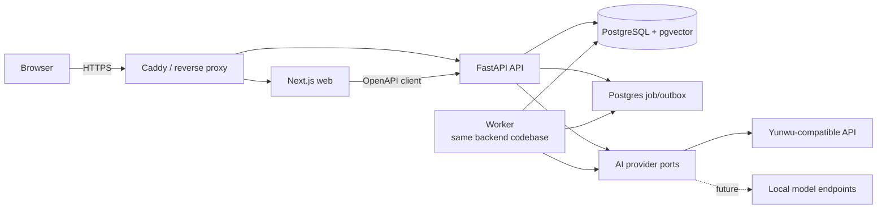

# Memora Initial Architecture

Status: Accepted baseline with personal and team Markdown workspaces

Last updated: 2026-08-06

## Architecture goal

在单台公网服务器上交付安全、可验证的四人测试版本，同时保留未来扩展产品模块、替换 AI 供应商和接入本地模型的清晰路径。

架构选择遵循一个约束：只为已经确认的变化方向保留边界，不为未知产品预建分布式系统。

## System shape



部署单位包括 `web`、`api`、`worker`、`postgres` 和反向代理。API 与 worker 来自同一后端代码库，因此仍属于模块化单体，不是微服务体系。

## Current Markdown workspace surface

当前 Web 提供个人与团队空间、选择性共享和 Markdown 记忆闭环。多 conversation 和报告界面
继续隐藏，但后端能力和历史数据不删除。

- 注册或新登录后，Web 优先进入用户的 `PERSONAL` 空间；已有 session 启动时恢复数据库会话
  中最近活动的空间。所有业务接口仍从服务端 session 解析活动空间。
- 侧栏列出当前用户具有 membership 的空间，并通过受保护的激活接口切换。桌面侧栏宽度和
  主工作区 split 比例是仅存于浏览器 localStorage 的可选布局偏好；pane 接近最小宽度时
  吸附隐藏，侧栏最小态仍保留品牌窄栏。移动端保持完整抽屉；未保存草稿会阻止切换。
- `TEAM` workspace 使用唯一可空的 12 位 `join_code`。`POST /workspaces/join` 在限流和
  代码校验后写入独立的 pending 申请，不创建 membership，也不激活团队；代码只在请求正文
  传输。
- `POST /workspaces/{workspace_id}/members` 只允许团队 `OWNER` 按规范化邮箱添加现有活跃
  用户。成员目录响应不包含邮箱，只返回昵称、角色、加入时间和当前用户标记。
- 当前团队 `OWNER` 可以列出、批准或拒绝 `workspace_join_requests`，批准与 membership 写入
  同事务完成。所有者移除普通成员时，先把其相关 session 切回个人 workspace。
- `POST /drafts/refine` 接收当前 Markdown 和用户指令，只返回修改后的草稿。它不创建 memory，也不把草稿正文写入审计日志。
- `POST /assets` 保存当前用户在当前 workspace 上传的 PNG、JPEG、WEBP 或 PDF 受保护
  资产。图片资产返回 `/api/assets/{id}/content` Markdown URL；读取 URL 必须重新验证
  session、workspace 和作者或当前可访问的共享 Markdown 引用。
- `POST /drafts/chat` 可以接收当前轮受限图片输入和受保护资产引用。图片在服务端校验
  后既可以作为当前轮视觉输入，也可以通过 Markdown URL 随用户保存的正文长期显示。
  PDF 不嵌入 Markdown；服务端只抽取有限文本作为当前轮不可信上下文。
- `POST /drafts/chat` 同时接受 `AUTO`、`REQUIRED` 或 `DISABLED` 联网模式。联网阶段
  返回受预算约束的摘要和 URL 来源，最终 Chat 阶段统一决定回答或更新 Markdown；
  API 只返回搜索候选白名单中被模型实际使用的 HTTP(S) 引用。
- 模型未配置时，空草稿确定性地保留用户原文；非空草稿保持不变。供应商失败时也不覆盖当前内容。
- `POST /memories` 仍是唯一的新记忆保存动作，缺省 `PRIVATE`。只有活动空间为 `TEAM` 且
  用户显式选择时才接受 `WORKSPACE`；个人空间在服务端拒绝共享可见性。
- 记忆库调用统一授权列表：成员可见本人在当前空间的记录，以及同一团队内所有作者的
  `WORKSPACE` 记录。前端显示作者与可见性，但不承担授权职责。
- memory 的 `title` 是从正文首个非空 Markdown 行派生的 nullable 检索投影。记忆库通过
  `POST /search` 组合纯关键词、标题、时间和作者条件，所有条件都位于授权候选查询之后。
- Chat 模型菜单从供应商无关注册表读取 GPT、Claude 和 Gemini 配置，选中的 registry ID
  解析为 provider model 后仍通过同一 `ChatModelPort` 调用。

### Immutable revisions

已保存 Markdown 不原地改写。每次修订都创建新的 memory 行：

- `timeline_entry_id` 是一个稳定的时间线条目标识。
- `timeline_visible` 决定该修订能否进入活动列表、搜索、报告和 AI 证据候选。
- “更新当前记忆”沿用来源 `timeline_entry_id`，隐藏来源修订并显示新修订。
- “保存为新版本”使用新的 `timeline_entry_id`，来源与新版本都保持可见。
- 修订历史按 `timeline_entry_id` 查询，只对活动条目的所有者开放。
- 删除一个时间线条目会清除同一 `timeline_entry_id` 下全部内部修订的正文、向量和未完成任务。

完整决策见 ADR-0003。

## Conversation-first Web orchestration

以下是此前已交付的 conversation-first 交互架构。当前 Markdown workspace MVP 暂时隐藏该
界面，但保留相关服务端接口和权限语义。

该版 Web 对用户只呈现一个 Chatbot 对话面。它在客户端维护短生命周期的交互状态，将“待保存内容 → 可见范围确认 → 创建/共享”、授权问答、显式时间报告，以及上一条记录的分享、取消共享、补充和删除编排到现有 OpenAPI 接口。

该编排不是新的权限边界：

- 新内容先调用创建接口成为 `PRIVATE`，只有用户明确选择团队后才继续调用分享接口；分享失败时保留私有记录并明确告知。
- 回顾默认使用 `PERSONAL`。只有消息明确包含团队含义或工作区成员显示名时，Web 才请求 `WORKSPACE` 或 `COLLEAGUE`；模糊的“这个同事”必须追问。
- 自然语言意图识别只改善交互，服务端仍独立验证身份、成员、范围、时间和引用授权。外部模型不决定可见性，不直接执行数据库操作。
- 报告仍要求可解析的显式时间范围；信息不足时在同一对话中继续追问，不通过隐藏默认值绕过产品约束。
- HTTP API 保持细粒度和可测试，所谓“统一接口”指统一用户界面，不把安全关键操作合并成无法审计的万能模型端点。

## Workspace and persistent conversation shell

v0.2 在同一模块化单体内增加工作区切换、持久化 conversation 历史和原始记忆浏览，不引入新的部署单元。

### Active workspace

- Cookie 仍只标识数据库中的不透明用户会话；会话记录当前活动 `workspace_id`。
- `GET /workspaces` 通过 `workspace_memberships` 列出当前用户可访问的空间。
- `POST /workspaces/{workspace_id}/activate` 先验证 membership，再更新当前会话的活动空间。
- 切换后的所有业务接口继续从服务端 `Principal.workspace_id` 获取范围，不接受前端自行声明的可信租户 ID。
- v0.2 接受同一浏览器多个标签共享最后一次活动空间的限制；出现真实并行空间需求后，再评估路径级 workspace 上下文。

### Personal and team spaces

- `workspaces.kind` 区分 `PERSONAL` 与 `TEAM`，但两者复用相同的 memory、检索和引用授权流水线。
- 每个 seed 用户通过幂等 seed 获得一个确定的个人空间，且只有该用户拥有 membership。
- 用户创建团队空间时成为 `OWNER`；所有者可直接添加现有账号，其他用户凭团队号创建待审
  申请，批准后成为 `MEMBER`。所有者可移除普通成员；所有权转移和团队号轮换仍不属于当前范围。
- 个人空间和团队空间之间默认不复制、不聚合 memory。

### Persistent conversations

- conversation 绑定 `workspace_id + user_id`，默认仅创建者可列出、读取、重命名或归档。
- `title`、`updated_at` 与 `archived_at` 支持侧栏历史和生命周期；归档不删除审计或消息。
- Chat 请求可以指定当前用户在活动空间内的 conversation，后续消息追加到同一 conversation。
- memory 创建可以指定 conversation；memory、embedding outbox、审计事件与 capture 消息在同一事务中写入。
- `messages.memory_id` 是可选的来源关联，用于在历史中呈现保存回执；它不改变 memory 的作者、可见性或事实来源。
- conversation 详情中的引用和关联 memory 在响应前重新经过当前授权查询。历史消息不能绕过撤回、删除或空间切换。

### Memory library

- 记忆库仍调用现有授权 memory 接口，不维护第二份记录投影。
- “我的记忆”增加服务端作者过滤，只返回当前用户记录。
- “团队共享”增加服务端 `WORKSPACE` 过滤，只返回当前空间内当前用户有权访问的共享记录。
- 原文抽屉每次通过 memory 详情接口加载；前端隐藏不是权限边界。
- 当前 Markdown 工作台复用 `POST /search` 提供纯关键词、标题和时间筛选；团队空间可加
  `author_id`。该参数不是授权声明，服务端仍先过滤 private memory。

## Technology baseline

- **Web**：Next.js App Router、React、TypeScript。
- **API and worker**：Python、FastAPI、Pydantic、SQLAlchemy、Alembic。
- **Database**：PostgreSQL，使用 pgvector 保存 embedding，并结合 PostgreSQL 关键词检索。
- **API contract**：FastAPI 生成 OpenAPI，前端使用生成的 TypeScript client。
- **Deployment**：Docker Compose 部署到单台 Linux 服务器，Caddy 负责 HTTPS 和反向代理。
- **Testing**：前端单元/组件测试、API 单元与集成测试、真实 PostgreSQL 集成测试、Playwright 关键路径测试。
- **Developer commands**：通过仓库根目录的稳定命令统一环境和验证流程。

不在规划文档中锁定精确依赖版本。创建工程骨架时根据官方兼容矩阵固定版本和 lockfile。

## Backend module boundaries

后端按业务能力组织，而不是按 controller/service/repository 技术层平铺：

```text
apps/api/
└── memora/
    ├── identity/       # 登录、会话、密码哈希、当前用户
    ├── workspaces/     # 工作区与成员关系
    ├── memories/       # 不可变记录、修订、分享、删除
    ├── retrieval/      # 权限过滤、关键词/向量召回、排序
    ├── conversations/  # 对话上下文和问题范围
    ├── reports/        # 个人/同事/团队报告编排
    ├── documents/      # PDF 解析、OCR、页级分块、引用与异步任务
    ├── agent/          # 公开计划、工具注册、执行状态与事件
    ├── ai/             # ChatModelPort、EmbeddingModelPort 与 adapters
    ├── api/drafts.py   # 无持久化的 Markdown 草稿修改编排
    ├── jobs/           # transactional outbox、重试和状态
    └── shared/         # 少量跨模块基础设施；禁止成为杂物目录
```

模块通过应用服务和明确类型协作。`retrieval` 可以读取已授权的 memory 投影，但 AI adapter 不得直接查询业务表或自行决定权限。

## Core data model

| Entity                  | Purpose                              | Important fields                                                                                                             |
| ----------------------- | ------------------------------------ | ---------------------------------------------------------------------------------------------------------------------------- |
| `users`                 | 测试账号和身份                       | id, email, password_hash, display_name, avatar_asset_id, status                                                              |
| `workspaces`            | 个人或团队隔离边界                   | id, name, kind, join_code                                                                                                    |
| `workspace_memberships` | 用户与工作区关系                     | workspace_id, user_id, role, created_at                                                                                      |
| `workspace_join_requests` | 不构成权限的团队加入申请           | workspace_id, user_id, status, requested_at, reviewed_at, reviewed_by_user_id                                               |
| `memories`              | 不可原地改写的想法与修订             | id, author_id, workspace_id, title, body, visibility, supersedes_id, timeline_entry_id, timeline_visible, revision_kind, created_at |
| `memory_embeddings`     | 可重建的检索投影                     | memory_id, model, dimensions, embedding, status                                                                              |
| `conversations`         | 用户私有 Chatbot 会话及默认范围      | id, user_id, workspace_id, title, scope, updated_at, archived_at                                                             |
| `messages`              | 问题、回答、capture 关联和生成元数据 | conversation_id, role, content, memory_id, model, usage                                                                      |
| `message_citations`     | 回答到原记录的可审计引用             | message_id, memory_id, excerpt                                                                                               |
| `assets`                | 受保护 Markdown 图片和文档来源       | id, workspace_id, owner_id, kind, content_type, size_bytes, sha256, content, deleted_at                                      |
| `document_parse_jobs`   | PDF 解析、OCR、取消和重试状态         | asset_id, workspace_id, owner_id, status, attempts, page_count, processed_pages, error_code                                  |
| `document_pages`        | 授权资产的页级抽取结果                | asset_id, page_number, extraction_method, text, quality_score                                                               |
| `document_chunks`       | 可独立重建向量的页级检索投影          | asset_id, page_number, heading, text, char_start, char_end, embedding_status, embedding                                      |
| `memory_document_citations` | 记忆到文档页的可审计引用快照      | memory_id, asset_id, chunk_id, page_number, heading, excerpt, ordinal                                                       |
| `agent_executions`      | 可取消和恢复的公开 Agent 执行         | id, workspace_id, actor_id, status, model_id, saved_memory_id, next_event_sequence, error_code, created_at, started_at, completed_at |
| `agent_events`          | 有序且不含隐藏推理的执行事件          | execution_id, sequence, step_id, kind, status, execution_status, title, detail, elapsed_ms, duration_ms, item_count, created_at |
| `jobs`                  | embedding 等异步任务                 | type, payload_ref, status, attempts, next_run_at                                                                             |
| `audit_events`          | 权限事件及不含正文的 AI 用量元数据   | actor_id, action, resource_id, model, input_tokens, output_tokens, created_at                                                |

`memories.visibility` v0.1 只有 `PRIVATE` 和 `WORKSPACE`。未来如果引入群组或点对点分享，必须通过新的 ADR 扩展，不能复用含义模糊的布尔字段。

## Memory lifecycle

1. API 验证当前用户和工作区成员关系。
2. 在同一数据库事务中写入 memory 和 embedding job。
3. 立即向用户返回已保存状态，不等待外部 AI。
4. worker 生成 embedding，记录模型、维度、状态和失败原因。
5. 失败任务按有上限的退避策略重试；记录仍可通过时间线和关键词找到。
6. 补充或修正通过新 memory 表达，并用 `supersedes_id` 关联来源。
7. “更新当前”隐藏旧修订；所有活动读取统一过滤 `timeline_visible = true`。
8. “保存为新版本”创建新的可见时间线条目，原条目保持可见。
9. 删除操作清除同一时间线条目的全部正文和 embedding，使其不再进入检索；审计事件不保留正文。

## Authorized retrieval and generation

任何问答或报告都必须执行以下顺序：

```text
authenticate
  → resolve workspace membership
  → resolve requested scope and time range
  → build authorized candidate query
  → hybrid keyword/vector retrieval
  → rerank within authorized candidates
  → construct minimal evidence context
  → generate structured answer and citations
  → verify every citation is still authorized
  → persist answer, citations and usage metadata
```

权限过滤属于数据库查询和应用服务规则，不能依赖“请不要泄露私有记录”一类提示词。建议使用 `workspace_id + author_id + visibility` 明确构造候选集合，并评估 PostgreSQL Row-Level Security 作为纵深防御；RLS 是否在 v0.1 启用需在实现计划中用集成测试验证其复杂度。

## Retrieval strategy

v0.1 使用混合检索：

- PostgreSQL 全文/关键词检索处理明确词语、名称和短语。
- pgvector 处理“类似想法”和表达不同但语义接近的记录。
- 时间、作者、工作区和可见性是硬过滤条件，不是排序提示。
- 返回给模型的每个片段携带稳定 memory ID、作者、时间和可访问链接。
- 变化报告按时间排序证据，要求模型区分延续、改变、矛盾和未知。

embedding 模型切换会改变向量空间。`memory_embeddings` 必须记录模型和维度；迁移时创建可恢复的重建任务，不能混用不同模型的向量进行相似度比较。

M4 的投影列使用 pgvector 可变维度 `vector`，查询必须同时硬过滤模型和维度。四人测试阶段采用精确余弦距离扫描；在真实模型、维度和数据量确定前不创建可能不匹配的近似索引。后续只有在观测到查询性能问题时，才针对确定的模型/维度用表达式或分区索引优化。pgvector 的 [SQLAlchemy 集成](https://github.com/pgvector/pgvector-python#sqlalchemy) 和 [可变维度向量说明](https://github.com/pgvector/pgvector#can-i-store-vectors-with-different-dimensions-in-the-same-column) 是该实现约束的上游依据。

搜索请求使用 `POST /search` 和 JSON body，避免用户的私有搜索词进入反向代理与应用的 URL
访问日志。请求可显式选择 `KEYWORD` 或 `HYBRID`，并以 `ALL` 或 `TITLE` 限定文本范围；纯
关键词和筛选请求不构造 embedding adapter。搜索响应明确标记语义能力为 `AVAILABLE`、
`DISABLED` 或 `DEGRADED`；禁用或供应商失败时保留授权关键词结果。

## AI provider boundary

定义三个独立端口：

- `ChatModelPort`：流式或非流式生成、结构化输出、受限图片输入、用量和错误归一化。
- `EmbeddingModelPort`：批量 embedding、模型标识、维度和用量。
- `WebSearchPort`：查询、搜索上下文深度、证据摘要、网页来源、用量和错误归一化。

基础设施 adapter 从环境变量读取 base URL、API Key、模型名、超时和重试配置。领域和应用模块只依赖端口，不引用云雾或任一模型 SDK 的专用类型。

当前兼容 adapter 按 OpenAI 的 [embeddings HTTP 契约](https://developers.openai.com/api/reference/resources/embeddings/methods/create) 发送请求并验证索引、有限浮点向量、模型与用量字段。配置为空时不构造 adapter，也不发起网络请求。

M5 的聊天 adapter 使用供应商兼容的 `v1/chat/completions` 端点；该端点仍被当前 OpenAI 文本模型列为支持的接口，例如 [Chat Latest 模型页](https://developers.openai.com/api/docs/models/chat-latest)。adapter 只负责 HTTP 契约和错误归一化，不读取数据库、不选择证据，也不决定引用。

多模态 capture 沿用相同端口。应用层只构造供应商无关的 `ChatImageInput`；兼容
adapter 将其转换为 Chat Completions 的 `image_url` data URL。服务端在调用 adapter
前重新校验 MIME、Base64、文件魔数、单图大小、数量和总大小，使用 `high` detail
支持截图文字识别。图片原始文件若由用户上传，会作为受保护 asset 存入 PostgreSQL；
OCR 中间结果不落库，供应商失败时保留当前 Markdown。

PDF 附件也先进入受保护 asset，并在同一事务中创建 `document_parse_jobs`。Worker 在文件大小、
页数、总字符、单页 OCR 超时、总执行时间、并发和重试上限内完成文本抽取；低文本质量页面
才调用本地 Tesseract OCR。页文本按页码、标题和章节边界生成 `document_chunks`，chunk
embedding 独立失败或重试，不阻塞资产与文本结果可用。

草稿 Chatbot 只能检索服务端在当前 `Principal`、workspace、owner、visibility 和删除状态下
授权的已完成 chunk。模型只可从服务端提供的 chunk ID 中声明实际使用来源；服务端再次校验
后返回页码引用。用户确认保存时只提交 chunk ID，`memory_document_citations` 保存受控页码与
摘录快照。删除资产会清除正文、页、chunk、向量和引用；取消团队共享后，非作者不能继续
读取引用资产。日志、审计与公开 Agent 事件不得记录 PDF 原文。

联网搜索 adapter 使用 OpenAI-compatible Responses API 的原生 `web_search` 工具，
而不是让应用任意抓取 URL。搜索与最终 Markdown 生成分为两次调用：搜索端口只获得
当前用户查询并产出带来源的证据；Chat 端口再结合对话、当前 Markdown、授权个人记忆
和网页证据生成结构化响应。网页摘要与来源均是不可信数据，数量、字符数和 URL 协议
受限。搜索无引用、超时或失败时不调用最终生成覆盖草稿。

`POST /drafts/refine` 复用 `ChatModelPort`，把当前 Markdown 作为不可信数据、把用户修改要求作为独立字段发送。模型只能返回完整 Markdown，不能执行保存。调用成功、禁用或失败都只写入不含正文的审计事件；成功调用同时记录模型和 token 用量。

个人 capture 界面使用独立的草稿 Chatbot endpoint，把有长度上限的本次会话、
当前 Markdown 和服务端授权筛选的个人记忆作为三个独立的不可信数据区传入模型。
模型返回结构化的聊天回复、草稿变更标记和完整 Markdown；服务端负责解析和长度
校验，并在模型声明不修改草稿时强制保留当前版本。个人记忆上下文必须来自统一授权
查询；优先在整个当前用户个人记忆向量投影上召回相关记录，embedding 不可用时降级
到最近记录。两种路径都设置记录数、单条正文和总字符预算，不能由前端上传记录正文
冒充检索结果。

`POST /chat/questions` 要求客户端显式传入范围和检索主题，问题与主题都放在 JSON body 中。服务端先用统一授权查询生成最多 12 条证据，再结束数据库事务并调用外部模型。模型输入中的 memory 正文被当作不可信数据；返回前重新授权所有证据，若生成期间发生撤回或删除，则丢弃模型答案并用剩余证据重建。无模型配置或供应商失败时使用确定性证据回答；没有证据时明确返回不知道。

回答、模型用量与引用分别写入 `messages` 和 `message_citations`。取消共享会使其他用户依赖该记录的历史回答失效并清空引用；删除会使所有依赖回答失效。这样持久化的旧引用不会在来源变回私有或消失后继续成为可用事实。

## On-demand report boundary

`POST /reports` 必须包含带时区的开始、结束时间和显式主题。个人报告读取当前用户自己的全部记录；同事报告只读取目标成员主动共享的记录；团队报告只读取所有成员的 `WORKSPACE` 记录，包括当前用户的私有记录也不会静默进入团队上下文。

第一版报告固定输出时间线、延续、变化、矛盾和证据缺口五部分。基础证据模式只描述数量、作者、时间、显式补充关系和原文差异，不自动把差异解释为立场改变，也不自动判定矛盾。外部聊天模型配置后只增强摘要，固定证据结构和引用仍由服务端生成；生成后再次应用相同范围过滤，撤回期间产生的模型摘要会被丢弃。

v0.1 报告不长期保存，也不导出文件，只写入不含正文的 `REPORT_GENERATED` 审计元数据。响应最多包含 30 条引用；删除或取消共享后，新报告不会再返回来源，当前页面也会在用户自己的相关操作后清除旧报告。

云雾公开快速开始文档给出了 OpenAI 兼容 base URL 和模型选择方式，但在实现前仍需用最低权限、最低额度的测试 Key 验证：

- 实际使用的 base URL。
- 聊天模型名称及流式响应兼容性。
- 是否提供满足需求的 embedding endpoint 和 embedding 模型。
- 错误格式、限流响应、用量字段和超时行为。

若聊天和 embedding 不能由同一服务可靠提供，两个端口允许分别配置供应商。未来本地模型只需实现同一端口，不应改变检索权限和产品逻辑。

## Authentication and authorization

- 匿名用户可通过 `POST /auth/register` 使用邮箱和密码注册。注册事务原子创建用户、
  `PERSONAL` 空间、OWNER 成员关系和会话；失败时整体回滚。
- 注册邮箱规范化后全局唯一，密码为 10–128 个字符并使用现有 Argon2 哈希。重复邮箱
  返回冲突，不创建第二个用户或孤立空间。
- seed 命令创建的四个账号和测试工作区继续用于开发验收；公开注册用户不会自动加入
  测试团队。
- 密码必须使用成熟的慢哈希算法保存，不能明文或可逆加密。
- 用户可在已认证会话中修改昵称、受保护头像和密码。头像复用 `assets` 二进制存储，
  `users.avatar_asset_id` 只允许指向当前用户上传的有效图片；读取头像仍需有效 session。
- 修改密码必须重新验证当前密码、重新生成 Argon2 哈希并撤销该用户除当前 session 外的
  其他活动 session。审计只记录动作和用户 ID，不记录密码、哈希或头像正文。
- 浏览器使用 Secure、HttpOnly、SameSite Cookie 会话；公网环境强制 HTTPS。
- 注册、登录、AI 调用和敏感接口设置基础速率限制。
- 作者才可以分享或删除自己的记录。
- 用户只能查询自己的私有记录和工作区共享记录。
- 所有权限规则必须有正向和反向集成测试，尤其验证用户 B 无法通过 ID、搜索、Chatbot、引用 URL 或报告看到用户 A 的私有记录。

## Secrets and configuration

- 仓库提交 `.env.example`，真实 `.env` 和 `.env.*` 被忽略。
- AI Key 只存在于 API/worker 服务端，绝不能使用 `NEXT_PUBLIC_` 暴露。
- 开发、测试和生产使用不同 Key、数据库和会话密钥。
- 云雾控制台若支持额度限制，应为 Memora 创建独立令牌并设置预算/额度。
- 生产部署最终应使用 Docker secret、systemd EnvironmentFile 或托管密钥服务；v0.1 可先使用服务器上权限受限的 `.env`。

## Cost controls

初始预算目标为人民币 1000 元以内，但不是硬性产品约束。

- 记录每次请求的 provider、model、operation、token/usage、延迟和估算成本。
- embedding 只对新记录或明确需要重建的数据执行。
- 检索后只发送最小必要上下文，不把整个知识库发送给模型。
- 为单次报告设置最大检索条数、最大输出和超时。
- 配置软预算告警；达到阈值后提醒管理员，但不在没有产品决定时静默破坏数据写入。

## Deployment and operations

- 单台 Linux 服务器运行 Docker Compose。
- Caddy 自动管理 TLS，数据库不暴露到公网。
- 只暴露 80/443；管理访问使用 SSH 密钥和防火墙限制。
- 每日数据库备份到服务器外的位置，并定期演练恢复。
- 健康检查区分进程存活、数据库可用和 AI provider 降级状态。
- 日志使用结构化字段和 request ID；不得记录 memory 正文、完整提示词、密码、Cookie 或 API Key。
- v0.1 先使用单实例 API/worker。出现真实容量或隔离需求后再评估横向扩展。

## Quality strategy

- 领域单元测试覆盖不可变修订、活动过滤、删除范围和分享规则。
- PostgreSQL 集成测试覆盖跨用户、跨工作区和删除后的检索隔离。
- AI adapter 使用契约测试和录制的脱敏响应，少量受控测试调用真实中转服务。
- 检索评测集从产品简报中的五类问题演化，记录 expected memory IDs 而不只比较自然语言。
- 浏览器验收覆盖登录、session 空间恢复、团队创建/加入、成员邀请、草稿显式可见性、跨用户隔离、
  两种修订行为和时间线。
- CI 必须能在没有真实生产 API Key 时运行；外部 AI 测试单独标记。

## Deferred decisions

- 精确依赖版本和 UI 组件库。
- 聊天与 embedding 的具体模型。
- PostgreSQL RLS 是否作为 v0.1 强制层。
- 报告是否长期保存以及导出格式。
- 备份恢复期和删除数据的备份淘汰策略。
- 域名、服务器发行版和部署供应商。
- 本地模型运行时和硬件规格。
