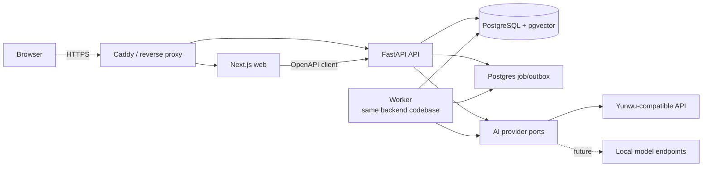

# Memora Initial Architecture

Status: Accepted baseline with personal Markdown surface

Last updated: 2026-07-26

## Architecture goal

在单台公网服务器上交付安全、可验证的四人测试版本，同时保留未来扩展产品模块、替换 AI 供应商和接入本地模型的清晰路径。

架构选择遵循一个约束：只为已经确认的变化方向保留边界，不为未知产品预建分布式系统。

## System shape



部署单位包括 `web`、`api`、`worker`、`postgres` 和反向代理。API 与 worker 来自同一后端代码库，因此仍属于模块化单体，不是微服务体系。

## Current personal Markdown surface

当前 Web 将已存在的团队、多空间、conversation 和报告能力隐藏，先验证个人 Markdown 记忆闭环。后端能力和历史数据不删除。

- 登录后，Web 通过受保护的 workspace 接口找到并激活当前用户的 `PERSONAL` 空间；所有业务接口仍从服务端 session 解析活动空间。
- 一级导航只有“记录想法”和“记忆库”。
- `POST /drafts/refine` 接收当前 Markdown 和用户指令，只返回修改后的草稿。它不创建 memory，也不把草稿正文写入审计日志。
- 模型未配置时，空草稿确定性地保留用户原文；非空草稿保持不变。供应商失败时也不覆盖当前内容。
- `POST /memories` 仍是唯一的新记忆保存动作；当前 Web 只创建 `PRIVATE` 记录。
- 记忆库调用现有授权列表，并额外指定当前作者和私有范围。

### Immutable revisions

已保存 Markdown 不原地改写。每次修订都创建新的 memory 行：

- `timeline_entry_id` 是一个稳定的时间线条目标识。
- `timeline_visible` 决定该修订能否进入活动列表、搜索、报告和 AI 证据候选。
- “更新当前记忆”沿用来源 `timeline_entry_id`，隐藏来源修订并显示新修订。
- “保存为新版本”使用新的 `timeline_entry_id`，来源与新版本都保持可见。
- 修订历史按 `timeline_entry_id` 查询，只对活动条目的所有者开放。
- 删除一个时间线条目会清除同一 `timeline_entry_id` 下全部内部修订的正文、向量和未完成任务。

完整决策见 ADR-0003。

## Conversation-first Web orchestration

以下是此前已交付的 conversation-first 交互架构。当前个人 Markdown MVP 暂时隐藏该界面，但保留相关服务端接口和权限语义。

该版 Web 对用户只呈现一个 Chatbot 对话面。它在客户端维护短生命周期的交互状态，将“待保存内容 → 可见范围确认 → 创建/共享”、授权问答、显式时间报告，以及上一条记录的分享、取消共享、补充和删除编排到现有 OpenAPI 接口。

该编排不是新的权限边界：

- 新内容先调用创建接口成为 `PRIVATE`，只有用户明确选择团队后才继续调用分享接口；分享失败时保留私有记录并明确告知。
- 回顾默认使用 `PERSONAL`。只有消息明确包含团队含义或工作区成员显示名时，Web 才请求 `WORKSPACE` 或 `COLLEAGUE`；模糊的“这个同事”必须追问。
- 自然语言意图识别只改善交互，服务端仍独立验证身份、成员、范围、时间和引用授权。外部模型不决定可见性，不直接执行数据库操作。
- 报告仍要求可解析的显式时间范围；信息不足时在同一对话中继续追问，不通过隐藏默认值绕过产品约束。
- HTTP API 保持细粒度和可测试，所谓“统一接口”指统一用户界面，不把安全关键操作合并成无法审计的万能模型端点。

## Workspace and persistent conversation shell

v0.2 在同一模块化单体内增加工作区切换、持久化 conversation 历史和原始记忆浏览，不引入新的部署单元。

### Active workspace

- Cookie 仍只标识数据库中的不透明用户会话；会话记录当前活动 `workspace_id`。
- `GET /workspaces` 通过 `workspace_memberships` 列出当前用户可访问的空间。
- `POST /workspaces/{workspace_id}/activate` 先验证 membership，再更新当前会话的活动空间。
- 切换后的所有业务接口继续从服务端 `Principal.workspace_id` 获取范围，不接受前端自行声明的可信租户 ID。
- v0.2 接受同一浏览器多个标签共享最后一次活动空间的限制；出现真实并行空间需求后，再评估路径级 workspace 上下文。

### Personal and team spaces

- `workspaces.kind` 区分 `PERSONAL` 与 `TEAM`，但两者复用相同的 memory、检索和引用授权流水线。
- 每个 seed 用户通过幂等 seed 获得一个确定的个人空间，且只有该用户拥有 membership。
- 用户创建团队空间时成为 `OWNER`；邀请、移除成员和所有权转移不属于 v0.2。
- 个人空间和团队空间之间默认不复制、不聚合 memory。

### Persistent conversations

- conversation 绑定 `workspace_id + user_id`，默认仅创建者可列出、读取、重命名或归档。
- `title`、`updated_at` 与 `archived_at` 支持侧栏历史和生命周期；归档不删除审计或消息。
- Chat 请求可以指定当前用户在活动空间内的 conversation，后续消息追加到同一 conversation。
- memory 创建可以指定 conversation；memory、embedding outbox、审计事件与 capture 消息在同一事务中写入。
- `messages.memory_id` 是可选的来源关联，用于在历史中呈现保存回执；它不改变 memory 的作者、可见性或事实来源。
- conversation 详情中的引用和关联 memory 在响应前重新经过当前授权查询。历史消息不能绕过撤回、删除或空间切换。

### Memory library

- 记忆库仍调用现有授权 memory 接口，不维护第二份记录投影。
- “我的记忆”增加服务端作者过滤，只返回当前用户记录。
- “团队共享”增加服务端 `WORKSPACE` 过滤，只返回当前空间内当前用户有权访问的共享记录。
- 原文抽屉每次通过 memory 详情接口加载；前端隐藏不是权限边界。

## Technology baseline

- **Web**：Next.js App Router、React、TypeScript。
- **API and worker**：Python、FastAPI、Pydantic、SQLAlchemy、Alembic。
- **Database**：PostgreSQL，使用 pgvector 保存 embedding，并结合 PostgreSQL 关键词检索。
- **API contract**：FastAPI 生成 OpenAPI，前端使用生成的 TypeScript client。
- **Deployment**：Docker Compose 部署到单台 Linux 服务器，Caddy 负责 HTTPS 和反向代理。
- **Testing**：前端单元/组件测试、API 单元与集成测试、真实 PostgreSQL 集成测试、Playwright 关键路径测试。
- **Developer commands**：通过仓库根目录的稳定命令统一环境和验证流程。

不在规划文档中锁定精确依赖版本。创建工程骨架时根据官方兼容矩阵固定版本和 lockfile。

## Backend module boundaries

后端按业务能力组织，而不是按 controller/service/repository 技术层平铺：

```text
apps/api/
└── memora/
    ├── identity/       # 登录、会话、密码哈希、当前用户
    ├── workspaces/     # 工作区与成员关系
    ├── memories/       # 不可变记录、修订、分享、删除
    ├── retrieval/      # 权限过滤、关键词/向量召回、排序
    ├── conversations/  # 对话上下文和问题范围
    ├── reports/        # 个人/同事/团队报告编排
    ├── ai/             # ChatModelPort、EmbeddingModelPort 与 adapters
    ├── api/drafts.py   # 无持久化的 Markdown 草稿修改编排
    ├── jobs/           # transactional outbox、重试和状态
    └── shared/         # 少量跨模块基础设施；禁止成为杂物目录
```

模块通过应用服务和明确类型协作。`retrieval` 可以读取已授权的 memory 投影，但 AI adapter 不得直接查询业务表或自行决定权限。

## Core data model

| Entity | Purpose | Important fields |
|---|---|---|
| `users` | 测试账号和身份 | id, email, password_hash, display_name, status |
| `workspaces` | 个人或团队隔离边界 | id, name, kind |
| `workspace_memberships` | 用户与工作区关系 | workspace_id, user_id, role |
| `memories` | 不可原地改写的想法与修订 | id, author_id, workspace_id, body, visibility, supersedes_id, timeline_entry_id, timeline_visible, revision_kind, created_at |
| `memory_embeddings` | 可重建的检索投影 | memory_id, model, dimensions, embedding, status |
| `conversations` | 用户私有 Chatbot 会话及默认范围 | id, user_id, workspace_id, title, scope, updated_at, archived_at |
| `messages` | 问题、回答、capture 关联和生成元数据 | conversation_id, role, content, memory_id, model, usage |
| `message_citations` | 回答到原记录的可审计引用 | message_id, memory_id, excerpt |
| `jobs` | embedding 等异步任务 | type, payload_ref, status, attempts, next_run_at |
| `audit_events` | 权限事件及不含正文的 AI 用量元数据 | actor_id, action, resource_id, model, input_tokens, output_tokens, created_at |

`memories.visibility` v0.1 只有 `PRIVATE` 和 `WORKSPACE`。未来如果引入群组或点对点分享，必须通过新的 ADR 扩展，不能复用含义模糊的布尔字段。

## Memory lifecycle

1. API 验证当前用户和工作区成员关系。
2. 在同一数据库事务中写入 memory 和 embedding job。
3. 立即向用户返回已保存状态，不等待外部 AI。
4. worker 生成 embedding，记录模型、维度、状态和失败原因。
5. 失败任务按有上限的退避策略重试；记录仍可通过时间线和关键词找到。
6. 补充或修正通过新 memory 表达，并用 `supersedes_id` 关联来源。
7. “更新当前”隐藏旧修订；所有活动读取统一过滤 `timeline_visible = true`。
8. “保存为新版本”创建新的可见时间线条目，原条目保持可见。
9. 删除操作清除同一时间线条目的全部正文和 embedding，使其不再进入检索；审计事件不保留正文。

## Authorized retrieval and generation

任何问答或报告都必须执行以下顺序：

```text
authenticate
  → resolve workspace membership
  → resolve requested scope and time range
  → build authorized candidate query
  → hybrid keyword/vector retrieval
  → rerank within authorized candidates
  → construct minimal evidence context
  → generate structured answer and citations
  → verify every citation is still authorized
  → persist answer, citations and usage metadata
```

权限过滤属于数据库查询和应用服务规则，不能依赖“请不要泄露私有记录”一类提示词。建议使用 `workspace_id + author_id + visibility` 明确构造候选集合，并评估 PostgreSQL Row-Level Security 作为纵深防御；RLS 是否在 v0.1 启用需在实现计划中用集成测试验证其复杂度。

## Retrieval strategy

v0.1 使用混合检索：

- PostgreSQL 全文/关键词检索处理明确词语、名称和短语。
- pgvector 处理“类似想法”和表达不同但语义接近的记录。
- 时间、作者、工作区和可见性是硬过滤条件，不是排序提示。
- 返回给模型的每个片段携带稳定 memory ID、作者、时间和可访问链接。
- 变化报告按时间排序证据，要求模型区分延续、改变、矛盾和未知。

embedding 模型切换会改变向量空间。`memory_embeddings` 必须记录模型和维度；迁移时创建可恢复的重建任务，不能混用不同模型的向量进行相似度比较。

M4 的投影列使用 pgvector 可变维度 `vector`，查询必须同时硬过滤模型和维度。四人测试阶段采用精确余弦距离扫描；在真实模型、维度和数据量确定前不创建可能不匹配的近似索引。后续只有在观测到查询性能问题时，才针对确定的模型/维度用表达式或分区索引优化。pgvector 的 [SQLAlchemy 集成](https://github.com/pgvector/pgvector-python#sqlalchemy) 和 [可变维度向量说明](https://github.com/pgvector/pgvector#can-i-store-vectors-with-different-dimensions-in-the-same-column) 是该实现约束的上游依据。

搜索请求使用 `POST /search` 和 JSON body，避免用户的私有搜索词进入反向代理与应用的 URL 访问日志。搜索响应明确标记语义能力为 `AVAILABLE`、`DISABLED` 或 `DEGRADED`；禁用或供应商失败时保留授权关键词结果。

## AI provider boundary

定义两个独立端口：

- `ChatModelPort`：流式或非流式生成、结构化输出、用量和错误归一化。
- `EmbeddingModelPort`：批量 embedding、模型标识、维度和用量。

基础设施 adapter 从环境变量读取 base URL、API Key、模型名、超时和重试配置。领域和应用模块只依赖端口，不引用云雾或任一模型 SDK 的专用类型。

当前兼容 adapter 按 OpenAI 的 [embeddings HTTP 契约](https://developers.openai.com/api/reference/resources/embeddings/methods/create) 发送请求并验证索引、有限浮点向量、模型与用量字段。配置为空时不构造 adapter，也不发起网络请求。

M5 的聊天 adapter 使用供应商兼容的 `v1/chat/completions` 端点；该端点仍被当前 OpenAI 文本模型列为支持的接口，例如 [Chat Latest 模型页](https://developers.openai.com/api/docs/models/chat-latest)。adapter 只负责 HTTP 契约和错误归一化，不读取数据库、不选择证据，也不决定引用。

`POST /drafts/refine` 复用 `ChatModelPort`，把当前 Markdown 作为不可信数据、把用户修改要求作为独立字段发送。模型只能返回完整 Markdown，不能执行保存。调用成功、禁用或失败都只写入不含正文的审计事件；成功调用同时记录模型和 token 用量。

`POST /chat/questions` 要求客户端显式传入范围和检索主题，问题与主题都放在 JSON body 中。服务端先用统一授权查询生成最多 12 条证据，再结束数据库事务并调用外部模型。模型输入中的 memory 正文被当作不可信数据；返回前重新授权所有证据，若生成期间发生撤回或删除，则丢弃模型答案并用剩余证据重建。无模型配置或供应商失败时使用确定性证据回答；没有证据时明确返回不知道。

回答、模型用量与引用分别写入 `messages` 和 `message_citations`。取消共享会使其他用户依赖该记录的历史回答失效并清空引用；删除会使所有依赖回答失效。这样持久化的旧引用不会在来源变回私有或消失后继续成为可用事实。

## On-demand report boundary

`POST /reports` 必须包含带时区的开始、结束时间和显式主题。个人报告读取当前用户自己的全部记录；同事报告只读取目标成员主动共享的记录；团队报告只读取所有成员的 `WORKSPACE` 记录，包括当前用户的私有记录也不会静默进入团队上下文。

第一版报告固定输出时间线、延续、变化、矛盾和证据缺口五部分。基础证据模式只描述数量、作者、时间、显式补充关系和原文差异，不自动把差异解释为立场改变，也不自动判定矛盾。外部聊天模型配置后只增强摘要，固定证据结构和引用仍由服务端生成；生成后再次应用相同范围过滤，撤回期间产生的模型摘要会被丢弃。

v0.1 报告不长期保存，也不导出文件，只写入不含正文的 `REPORT_GENERATED` 审计元数据。响应最多包含 30 条引用；删除或取消共享后，新报告不会再返回来源，当前页面也会在用户自己的相关操作后清除旧报告。

云雾公开快速开始文档给出了 OpenAI 兼容 base URL 和模型选择方式，但在实现前仍需用最低权限、最低额度的测试 Key 验证：

- 实际使用的 base URL。
- 聊天模型名称及流式响应兼容性。
- 是否提供满足需求的 embedding endpoint 和 embedding 模型。
- 错误格式、限流响应、用量字段和超时行为。

若聊天和 embedding 不能由同一服务可靠提供，两个端口允许分别配置供应商。未来本地模型只需实现同一端口，不应改变检索权限和产品逻辑。

## Authentication and authorization

- v0.1 由 seed 命令创建四个账号和一个工作区，不开放注册。
- 密码必须使用成熟的慢哈希算法保存，不能明文或可逆加密。
- 浏览器使用 Secure、HttpOnly、SameSite Cookie 会话；公网环境强制 HTTPS。
- 登录、AI 调用和敏感接口设置基础速率限制。
- 作者才可以分享或删除自己的记录。
- 用户只能查询自己的私有记录和工作区共享记录。
- 所有权限规则必须有正向和反向集成测试，尤其验证用户 B 无法通过 ID、搜索、Chatbot、引用 URL 或报告看到用户 A 的私有记录。

## Secrets and configuration

- 仓库提交 `.env.example`，真实 `.env` 和 `.env.*` 被忽略。
- AI Key 只存在于 API/worker 服务端，绝不能使用 `NEXT_PUBLIC_` 暴露。
- 开发、测试和生产使用不同 Key、数据库和会话密钥。
- 云雾控制台若支持额度限制，应为 Memora 创建独立令牌并设置预算/额度。
- 生产部署最终应使用 Docker secret、systemd EnvironmentFile 或托管密钥服务；v0.1 可先使用服务器上权限受限的 `.env`。

## Cost controls

初始预算目标为人民币 1000 元以内，但不是硬性产品约束。

- 记录每次请求的 provider、model、operation、token/usage、延迟和估算成本。
- embedding 只对新记录或明确需要重建的数据执行。
- 检索后只发送最小必要上下文，不把整个知识库发送给模型。
- 为单次报告设置最大检索条数、最大输出和超时。
- 配置软预算告警；达到阈值后提醒管理员，但不在没有产品决定时静默破坏数据写入。

## Deployment and operations

- 单台 Linux 服务器运行 Docker Compose。
- Caddy 自动管理 TLS，数据库不暴露到公网。
- 只暴露 80/443；管理访问使用 SSH 密钥和防火墙限制。
- 每日数据库备份到服务器外的位置，并定期演练恢复。
- 健康检查区分进程存活、数据库可用和 AI provider 降级状态。
- 日志使用结构化字段和 request ID；不得记录 memory 正文、完整提示词、密码、Cookie 或 API Key。
- v0.1 先使用单实例 API/worker。出现真实容量或隔离需求后再评估横向扩展。

## Quality strategy

- 领域单元测试覆盖不可变修订、活动过滤、删除范围和分享规则。
- PostgreSQL 集成测试覆盖跨用户、跨工作区和删除后的检索隔离。
- AI adapter 使用契约测试和录制的脱敏响应，少量受控测试调用真实中转服务。
- 检索评测集从产品简报中的五类问题演化，记录 expected memory IDs 而不只比较自然语言。
- 浏览器验收覆盖登录、个人空间激活、草稿修改、明确保存、两种修订行为和时间线。
- CI 必须能在没有真实生产 API Key 时运行；外部 AI 测试单独标记。

## Deferred decisions

- 精确依赖版本和 UI 组件库。
- 聊天与 embedding 的具体模型。
- PostgreSQL RLS 是否作为 v0.1 强制层。
- 报告是否长期保存以及导出格式。
- 备份恢复期和删除数据的备份淘汰策略。
- 域名、服务器发行版和部署供应商。
- 本地模型运行时和硬件规格。
