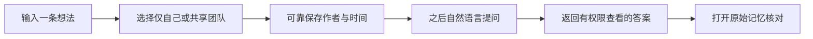

# Memora 最小可交付版本需求文档

Status: Draft for review

Document version: R0

Target release: MVP simplification

Owner: Yihua Qin

Last updated: 2026-07-26

## 0. 文档目的

本文档用于确定 Memora 第一轮真实用户测试的最小产品范围。它不是现有代码功能清单，也不意味着已经批准修改产品或删除已实现能力。

在本文档获得批准前：

- `docs/product/brief.md` 仍是正式产品基线。
- ADR-0001 和 ADR-0002 仍然有效。
- 不根据本文档改动现有 Web、API、数据库或部署。

批准本文档后，应先把确认的决定同步到正式 product brief；如果决定长期取消多空间或持久 conversation，再单独更新或补充 ADR。第一轮建议只在前端隐藏非核心能力，不删除后台模型和数据，以便低成本恢复。

---

## 1. 产品结论

### 1.1 一句话定义

Memora 是一个可以把零散想法可靠存下来，并让用户之后通过自然语言、带原文依据地找回这些想法的 Web 工具。

### 1.2 MVP 只验证一个核心闭环



如果这个闭环不能被四位测试者持续使用，那么组织架构、分析看板、多 conversation 和更复杂的 AI 能力都没有优先建设的依据。

### 1.3 MVP 不验证什么

MVP 不验证 Memora 是否能成为完整的企业知识管理平台，也不验证：

- 是否能替代飞书组织管理。
- 是否能管理部门、角色或企业权限。
- 是否能自动生成高质量管理报告。
- 是否能支持多个组织和大量 conversation。
- 是否能导入文件或替代现有文档系统。
- 是否能直接减少会议时间。

“减少会议时间”距离核心行为太远，容易受到团队习惯、项目阶段和样本量影响，不适合作为第一轮成败指标。

---

## 2. 对当前产品假设的挑战

### 2.1 “团队产品就需要组织架构管理”

不成立。

第一轮只有四位已知测试者。部门树、邀请成员、角色编辑和组织可见范围会显著增加权限、审计和界面复杂度，但不会直接证明用户愿意记录和找回想法。

MVP 建议：

- 使用一个固定测试团队。
- 使用四个预置账号。
- 不在主界面提供创建组织、邀请成员、删除成员或角色编辑。
- 只展示“仅自己”和“团队共享”两种记忆可见范围。

### 2.2 “有 Chatbot 就应该有多个聊天窗口”

不成立。

Memora 的长期资产是 memory，不是 conversation。多个 conversation 会带来命名、历史整理、归档和“记忆属于哪个聊天”的理解成本，但不提升核心记录质量。

MVP 建议：

- 主界面保持一个统一对话面。
- 不在左栏展示 conversation 历史。
- 服务端可以继续保存消息，以支持刷新恢复和问题上下文。
- memory 不归属于某个 conversation 文件夹。

### 2.3 “分析是核心能力，所以第一版必须有分析页”

不成立。

当每人只有少量记录时，分析页最容易生成“形式完整但证据不足”的报告，反而损害信任。第一轮首先要验证记录量、找回率和引用可信度。

MVP 建议：

- 从一级导航移除“分析”。
- 暂不提供独立报告配置页。
- 可以保留已有报告 API，但不作为 MVP 验收项。
- 当至少三位用户连续两周各自记录十五条以上真实想法后，再评估恢复分析入口。

### 2.4 “上传记忆”比“记录记忆”更像一个产品功能

不成立。

当前只支持纯文本。“上传”会让用户合理预期文件、图片、音频、批量导入和处理进度。

MVP 统一使用：

- “记录想法”或“记录记忆”。
- 不使用“上传”。
- 只有真正支持文件后，才增加“上传文件”这一独立能力。

### 2.5 “更多入口会让功能更容易发现”

不一定成立。

一级入口越多，用户越需要先理解系统结构。MVP 的发现问题可以用首次引导和示例问题解决，而不是增加导航。

建议一级导航只保留：

1. 记忆助手
2. 原始记忆

---

## 3. 目标用户与使用条件

### 3.1 第一轮用户

- 固定四位内部测试者。
- 能理解外部大模型 API 处理数据的测试说明。
- 愿意连续两周记录真实工作想法。
- 彼此属于同一个测试团队，但每条想法不一定适合共享。

### 3.2 典型使用场景

#### 场景 A：快速记录

用户刚产生一个产品、商业或执行想法，希望在约十五秒内完成记录。

#### 场景 B：找回过去观点

用户记不清自己过去对一个主题的看法，希望找到当时原文和时间。

#### 场景 C：查找类似想法

用户想知道自己以前是否出现过相似想法，即使使用了不同表达。

#### 场景 D：读取团队共享上下文

用户希望了解同事主动共享过的想法或进展，不读取任何同事私有内容。

---

## 4. MVP 功能范围

### 4.1 P0：必须交付

| 编号  | 功能             | 用户价值             | 进入 MVP 的原因          |
| ----- | ---------------- | -------------------- | ------------------------ |
| P0-01 | 预置账号登录     | 区分作者与权限       | 所有隐私和团队能力的前提 |
| P0-02 | 纯文本记录       | 保存即时想法         | 核心输入                 |
| P0-03 | 保存范围确认     | 私有或主动共享       | 核心权限承诺             |
| P0-04 | 自然语言找回     | 找到过去记录         | 核心输出                 |
| P0-05 | 团队授权问答     | 使用主动共享内容     | 验证最小团队价值         |
| P0-06 | 原文引用         | 核对作者、时间和原文 | 建立 AI 信任             |
| P0-07 | 原始记忆列表     | 不依赖 AI 浏览数据   | 提供事实来源与管理入口   |
| P0-08 | 分享、撤回和删除 | 控制已保存数据       | 隐私闭环必须完整         |
| P0-09 | AI 降级          | 模型异常时记录不丢失 | 可靠性底线               |

### 4.2 P1：MVP 后再决定

| 功能                 | MVP 处理                 | 恢复条件                             |
| -------------------- | ------------------------ | ------------------------------------ |
| 独立分析页           | 从导航隐藏               | 用户达到足够记录量并主动要求周期回顾 |
| 个人/团队报告        | 不作为验收项             | 两周实验完成且引用找回可信           |
| 多 conversation 历史 | 从导航隐藏               | 用户确实需要按任务恢复聊天上下文     |
| 多空间切换           | 第一轮固定一个测试团队   | 出现第二个真实团队或明确隔离需求     |
| 创建团队空间         | 隐藏                     | 有非开发者用户需要自助创建团队       |
| 成员与权限页面       | 隐藏                     | 需要邀请、移除或角色管理时统一设计   |
| 补充/修正关系        | 保留后台能力，界面可暂缓 | 用户实际发生“观点演进”记录需求       |
| 复杂筛选             | 暂不提供                 | 原始记忆量导致列表不可用             |

### 4.3 明确不做

- 注册、邀请、找回密码、企业 SSO。
- 文件、图片、语音、视频和网页导入。
- 部门树、用户组和细粒度权限。
- 共享 conversation 或多人共同编辑。
- 自动标签、知识图谱和主题管理。
- 定时报告、消息推送和报告导出。
- 原生移动应用和浏览器插件。
- 跨团队搜索。
- AI 推断心理状态、绩效或未记录的经历。

---

## 5. 最简信息架构

### 5.1 桌面端

```text
┌──────────────────┬───────────────────────────────────────────────┐
│ Memora           │ 当前页面标题                     新记录默认私有 │
│                  ├───────────────────────────────────────────────┤
│ ● 记忆助手       │                                               │
│   原始记忆       │              对话 / 原始记忆内容               │
│                  │                                               │
│                  │                                               │
│                  ├───────────────────────────────────────────────┤
│ Alex             │ 输入想法，或询问过去的记忆              发送 │
└──────────────────┴───────────────────────────────────────────────┘
```

左栏不展示：

- 空间创建和切换。
- “记录记忆”大型按钮。
- 分析。
- 成员与权限。
- 最近 conversation。

“记录”和“提问”共用记忆助手输入框，不增加模式切换。

每个用户在固定测试团队中只看到一个当前对话。刷新后可以恢复最近消息，但不提供新建、重命名、归档或选择 conversation 的界面；服务端可以继续保留现有 conversation 数据结构。

### 5.2 移动端

- 顶部只显示页面标题和菜单按钮。
- 菜单抽屉只包含“记忆助手”“原始记忆”和账号退出。
- 输入框固定在对话区域底部。
- 原始记忆详情使用全屏抽屉。

### 5.3 原始记忆页

只包含两个页签：

1. 我的记忆
2. 团队共享

“我的记忆”包含当前用户在测试团队中的私有和已共享记录。

“团队共享”只包含四位成员主动共享的记录。页面必须持续显示“不包含任何成员私有内容”的说明。

---

## 6. 详细功能需求

### FR-01 登录

#### 用户目标

用户使用预置账号进入自己的权限范围。

#### 功能规则

1. 系统提供四个预置账号。
2. 用户使用邮箱和密码登录。
3. 登录成功后进入“记忆助手”。
4. 登录状态通过安全 Cookie 保存。
5. 不提供公开注册、账号邀请和密码找回。
6. 登录失败只返回通用错误，不泄露账号是否存在。
7. 连续失败需要基础速率限制。

#### 验收

- 正确账号可以登录。
- 错误密码不能登录。
- 未登录用户不能调用 memory、问答或原文接口。
- 用户 A 登录后不能获得用户 B 的私有记忆。

---

### FR-02 记录纯文本想法

#### 用户目标

用户在不离开对话页的情况下记录一条想法。

#### 触发规则

用户输入一段普通陈述，例如：

> 我觉得 Memora 早期应该先卖给小团队，而不是个人订阅。

系统将其识别为待保存内容，而不是事实问题。

#### 交互

1. 用户发送文本。
2. 助手回复：“这条想法仅自己可见，还是共享给团队？”
3. 展示两个操作：
   - 仅自己
   - 共享团队
4. 用户明确选择后才写入 memory。
5. 保存成功后回复：
   - “已保存，仅你可见。”
   - 或“已保存，并共享给团队。”
6. 回执包含作者、时间和可见范围，可打开原始记忆。

#### 数据规则

- 正文为纯文本，去除首尾空白后不能为空。
- 单条正文最多 10,000 个字符。
- 服务端生成作者和创建时间。
- 新建 memory 的初始状态必须是 `PRIVATE`。
- 用户选择团队共享时，先成功创建私有记录，再执行显式分享。
- 分享失败时保留私有记录，并明确告知“已私有保存，但共享失败”。
- embedding 失败不能导致正文保存失败。
- 正文不能原地编辑。

#### 中断规则

- 用户未选择可见范围时，内容只是 conversation 中的待确认草稿，不进入知识库。
- 用户发送新的无关内容时，系统应先提醒完成或取消当前草稿。
- 切换页面或刷新后，未保存草稿是否恢复属于待确认问题，默认不恢复。

#### 验收

- 未选择范围前，原始记忆列表中不存在该内容。
- 选择“仅自己”后，其他账号的列表、问答、报告和原文 URL 均不可见。
- 选择“共享团队”后，团队成员可在“团队共享”中看到。
- 外部 AI 不可用时仍能保存正文。

---

### FR-03 询问自己的记忆

#### 用户目标

用户通过自然语言找回自己的历史记录。

#### 支持的问题

- 我之前对商业模式是什么看法？
- 我以前出现过类似想法吗？
- 我什么时候第一次提到这个方向？
- 我最近记录了什么？

#### 范围规则

- 默认只搜索当前用户自己的记忆。
- 自己已经共享的记录仍属于“自己的记忆”，可以被个人问题检索。
- 用户没有明确表示团队、我们或具体同事时，不扩大到团队范围。
- 问题中的时间或主题不足以可靠解析时，助手必须追问。

#### 回答规则

1. 服务端先完成身份、团队和可见性过滤。
2. 再执行关键词和语义召回。
3. 回答只能描述召回证据可以支持的内容。
4. 每个事实性回答至少提供一条引用，除非明确回答“没有找到”。
5. 证据不足时必须说不知道或没有找到。
6. 不把语义相似直接表述为观点相同。
7. 不推断用户未记录的动机、情绪或经历。

#### 引用内容

每条引用包含：

- 原始记忆摘录。
- 作者。
- 创建时间。
- 当前可见范围。
- 打开原始记忆的操作。

#### 验收

- 有匹配记录时，回答引用正确 memory。
- 没有匹配记录时，不生成虚构答案。
- 引用被删除后，历史页面不能继续暴露原文。
- 引用被撤回共享后，其他成员不能通过历史回答重新打开。

---

### FR-04 询问团队共享记忆

#### 用户目标

用户基于团队成员主动共享的记录了解公开上下文。

#### 触发规则

只有在问题明确包含以下意图时，才使用团队范围：

- 团队、我们、大家。
- 某位可识别的团队成员姓名。
- 明确要求“团队共享内容”。

“这个同事最近怎么样”没有指定成员时，助手必须追问，不得自行选择。

#### 范围规则

| 问题范围 | 可以使用的内容                 | 不可以使用的内容             |
| -------- | ------------------------------ | ---------------------------- |
| 我的记忆 | 当前用户私有及已共享记录       | 其他成员记录                 |
| 指定同事 | 该同事在当前团队主动共享的记录 | 该同事私有记录、其他成员记录 |
| 团队     | 当前团队全部 `WORKSPACE` 记录  | 任意成员 `PRIVATE` 记录      |

#### 回答规则

- 回答顶部或元信息中显示“范围：团队共享”或具体成员。
- 提到成员想法时显示作者和记录时间。
- 只能表述“某成员记录/分享了什么”，不能表述“某成员真实经历了什么”，除非原文明确记录。
- 没有共享证据时，回答“没有找到该成员主动共享的相关记录”。

#### 验收

- 用户 B 的私有记录不会进入用户 A 的候选集、模型提示词、引用或日志。
- 同事取消共享后，新问题不能再召回该记录。
- 通过直接 memory ID 请求也不能越权访问。

---

### FR-05 浏览原始记忆

#### 用户目标

用户不依赖 AI 即可检查知识库中的事实来源。

#### 页面结构

##### 我的记忆

- 展示当前用户在当前测试团队中的私有和已共享记录。
- 按创建时间倒序。
- 每条显示正文摘要、时间和可见范围。

##### 团队共享

- 展示当前团队全部主动共享记录。
- 按创建时间倒序。
- 每条显示正文摘要、作者和时间。
- 持续显示“团队共享不包含任何成员私有内容”。

#### MVP 不提供

- 复杂组合筛选。
- 自动标签。
- 文件夹。
- 批量操作。
- 无限层级主题分类。

#### 空状态

- 我的记忆为空：“还没有记忆，回到记忆助手记录第一条想法。”
- 团队共享为空：“还没有成员主动共享记忆。”

#### 验收

- 两个页签的数据范围符合权限矩阵。
- 点击卡片前，前端列表已经是服务端过滤后的授权结果。
- 点击卡片时重新调用原文接口验证当前权限。

---

### FR-06 原始记忆详情与管理

#### 用户目标

用户核对原文，并管理自己记录的共享和删除状态。

#### 详情内容

- 完整正文。
- 作者。
- 创建时间。
- 可见范围。
- 检索处理状态。

#### 作者可执行

- 私有记录：共享给团队。
- 已共享记录：撤回为仅自己可见。
- 删除记录。

#### 非作者

- 只能读取仍处于共享状态的记录。
- 不显示分享、撤回或删除操作。

#### 删除规则

1. 必须二次确认。
2. 删除后正文从活动数据中移除。
3. embedding 从活动索引中移除。
4. 新检索不能返回该记录。
5. 历史引用不得继续展示正文。
6. 审计日志只保留必要的非正文元数据。

#### 验收

- 只有作者可以分享、撤回和删除。
- 前端隐藏按钮之外，服务端也必须拒绝越权操作。
- 撤回和删除后的引用授权立即失效。

---

### FR-07 AI 与检索降级

#### 用户目标

外部 AI 服务异常时，用户仍能记录和找到基础信息。

#### 降级顺序

1. memory 写入不依赖 embedding 成功。
2. embedding 暂不可用时保留关键词检索。
3. Chat 模型不可用时返回确定性的证据列表和摘录。
4. 没有证据时明确说明没有找到。
5. 不把供应商错误、API Key 或内部堆栈返回给用户。

#### 状态文案

- 正常：“AI 回答”
- 模型失败：“AI 暂时不可用，以下是可核对的相关记录”
- embedding 处理中：“已保存；语义检索仍在处理，关键词检索可用”
- 完全无法连接 API：“暂时无法完成问答，请稍后重试；你的已保存记忆没有受到影响”

#### 验收

- 关闭外部模型配置后，登录、记录、浏览、分享和删除仍可使用。
- Chat 模型超时不会重复创建 memory。
- AI 调用有明确超时和有限重试，不无限阻塞请求。

---

## 7. 对话意图规则

MVP 不追求用 AI 识别所有语言，而是优先保证可预测。

| 用户输入                                         | 系统行为                                     |
| ------------------------------------------------ | -------------------------------------------- |
| 普通陈述                                         | 进入待保存范围确认                           |
| 包含“我之前、什么时候、有没有、找一下”等回顾意图 | 执行个人记忆问答                             |
| 明确包含“团队、我们、大家”                       | 执行团队共享问答                             |
| 明确包含成员姓名                                 | 执行该成员共享记忆问答                       |
| “这个、类似、这段时间”等指代不清                 | 追问主题或时间                               |
| “删除刚才那条”                                   | 找到作者最近记录并二次确认                   |
| 无法可靠判断                                     | 询问“你想保存这段内容，还是查找过去的记忆？” |

意图识别只决定交互流程，不决定最终权限。所有权限仍由服务端验证。

---

## 8. 权限与隐私要求

### 8.1 权限矩阵

| 数据                |           作者 | 同团队其他成员 |                           外部模型 |
| ------------------- | -------------: | -------------: | ---------------------------------: |
| 作者私有 memory     |           可见 |         不可见 | 仅作者发起相关请求时，最小必要发送 |
| 作者共享 memory     |           可见 |           可见 |           授权请求时，最小必要发送 |
| 作者 conversation   |           可见 |         不可见 |       只发送完成当前请求所需上下文 |
| 删除后的正文        | 不可从产品恢复 |         不可见 |                           不再发送 |
| 密码/API Key/Cookie |     不读取明文 |         不可见 |                           绝不发送 |

### 8.2 外部模型披露

四位测试者开始使用前必须明确知道：

- 授权范围内的记忆可能发送至外部 AI 中转服务。
- 系统会尽量只发送完成当前问题所需的片段。
- 私有记录不会因加入团队而自动共享给其他成员。
- AI 可能出错，事实回答必须通过引用核对。

### 8.3 日志

日志不得包含：

- memory 完整正文。
- 完整提示词。
- 密码。
- Cookie 和会话令牌。
- API Key。
- 生产数据库连接串。

---

## 9. 非功能需求

### 9.1 性能目标

- 页面初次打开：本地和正常服务器网络下，主要界面应在 2 秒左右可交互。
- memory 保存接口：不等待 embedding，目标 1 秒内返回。
- 基础关键词找回：目标 2 秒内返回。
- AI 问答：目标 15 秒内返回或明确超时降级。

这些是测试目标，不是正式 SLA。

### 9.2 可用性

- 支持桌面浏览器和 390px 宽移动浏览器。
- 核心路径全程可使用键盘。
- 按钮、输入框和状态有可访问名称。
- 加载、空状态、失败和成功都有可见反馈。
- 尊重 `prefers-reduced-motion`。

### 9.3 数据可靠性

- PostgreSQL 是唯一事实来源。
- memory 和 embedding job 在同一事务中创建。
- embedding 失败可观察、可重试。
- 每日数据库备份和恢复方案在公网测试前明确。

### 9.4 安全

- 公网强制 HTTPS。
- Cookie 使用 HttpOnly、Secure 和 SameSite。
- 数据库端口不暴露公网。
- 身份、memory ID、搜索、Chat、引用和删除均有越权测试。

---

## 10. 关键用户路径

### 路径 A：保存私有想法

```text
登录
→ 输入一条想法
→ 选择“仅自己”
→ 收到私有保存回执
→ 在“我的记忆”中找到
→ 其他账号无法找到
```

### 路径 B：主动共享

```text
输入一条想法
→ 选择“共享团队”
→ 收到共享回执
→ 其他账号在“团队共享”中找到
→ 其他账号可以在团队问题中引用
```

### 路径 C：找回个人观点

```text
提问“我之前对商业模式是什么看法？”
→ 默认只检索自己的记录
→ 返回简洁回答
→ 显示原文、作者、时间引用
→ 点击引用打开原始记忆
```

### 路径 D：撤回共享

```text
作者打开已共享记忆
→ 撤回为仅自己可见
→ 团队列表立即不再显示
→ 同事新问题不再召回
→ 同事历史引用不能继续打开原文
```

### 路径 E：AI 服务异常

```text
外部模型不可用
→ 用户仍能保存记忆
→ 问答降级为授权证据列表
→ 页面明确说明 AI 暂时不可用
→ 不丢失或重复写入正文
```

---

## 11. MVP 验收场景

### AC-01 默认私有

Given 用户 Alex 已登录  
When Alex 保存一条记忆并选择“仅自己”  
Then Blair 的列表、搜索、Chat、引用 URL 和报告接口均不能获得该记录。

### AC-02 主动共享

Given Alex 有一条私有记录  
When Alex 明确将其共享给团队  
Then Blair 可以在团队共享列表和授权问答中获得该记录，并看到作者与时间。

### AC-03 有依据找回

Given Alex 记录过与商业模式相关的内容  
When Alex 询问过去观点  
Then 回答引用正确原文；如果找不到，则明确说没有找到。

### AC-04 撤回传播

Given Blair 曾经引用 Alex 的共享记录  
When Alex 撤回共享  
Then Blair 不能通过新问题、列表、直接 ID 或旧引用继续读取正文。

### AC-05 删除传播

Given Alex 删除一条记录  
When 任意用户再次检索  
Then 正文和 embedding 均不再进入活动结果，历史回答标记来源已撤回或删除。

### AC-06 AI 降级

Given 外部 Chat 或 embedding 服务不可用  
When 用户记录或查询  
Then 记录仍可靠保存，查询返回授权关键词证据或清晰错误，不发生越权和数据丢失。

### AC-07 移动端

Given 390×844 浏览器视口  
When 用户完成登录、记录、范围选择、问答和原文查看  
Then 无横向滚动，主要操作不会被导航或键盘遮挡。

---

## 12. 两周验证方案

### 12.1 测试要求

- 四位用户连续使用两周。
- 每人目标记录十五条真实想法。
- 每人至少完成：
  - 三次个人找回。
  - 一次相似想法查找。
  - 一次团队共享。
  - 一次读取同事共享信息。
  - 一次撤回或删除验证。

### 12.2 核心指标

| 指标       |                                    目标 | 说明                        |
| ---------- | --------------------------------------: | --------------------------- |
| 激活       |            4 人中至少 3 人记录 5 条以上 | 判断是否愿意开始使用        |
| 持续记录   |               4 人中至少 3 人达到 15 条 | 判断记录入口是否形成习惯    |
| 记录摩擦   |                    典型记录约 15 秒完成 | 从输入到保存成功            |
| 找回有用率 |   至少 80% 的测试问题找到正确或有用记录 | 同时记录 expected memory ID |
| 引用完整率 |            事实性回答 100% 有可访问引用 | 无证据回答除外              |
| 隐私泄漏   |                  自动化和人工测试均为 0 | 阻塞性指标                  |
| 团队价值   | 至少 3 人成功读取过有用的主动共享上下文 | 不要求减少会议时间          |

### 12.3 失败判定

以下任一情况需要暂停扩展功能：

- 用户不愿持续记录。
- 大多数问题无法找到正确 memory。
- 用户无法理解私有和团队共享的区别。
- 回答看似流畅但引用不支持结论。
- 发生任何跨用户私有数据泄漏。
- AI 故障导致 memory 丢失或重复创建。

---

## 13. MVP 之后的功能解锁顺序

只有核心实验通过后，建议按以下顺序恢复能力：

1. **简单时间回顾**：最近 7/30 天个人摘要。
2. **团队共享摘要**：只使用 `WORKSPACE` 记录。
3. **报告页**：当报告确实被反复使用后再提供配置界面。
4. **conversation 历史**：当用户明确需要分任务恢复对话时。
5. **第二个真实团队**：出现后再恢复多空间切换。
6. **邀请和成员管理**：与审计、撤销和成员离开规则一起设计。
7. **文件导入**：独立验证来源、解析、权限和删除传播。

不要因为后台已经实现某项能力，就默认应该在 UI 中持续展示。

---

## 14. 待审阅决定

请重点审阅以下决定。括号内是当前建议。

### D-01 第一轮是否固定一个测试团队？

建议：**是**。

影响：主界面隐藏空间切换和创建团队；后台 workspace 模型保留。

### D-02 是否从侧栏移除 conversation 历史？

建议：**是**。

影响：用户只看到统一记忆助手；服务端仍可保存消息，不删除历史数据。

### D-03 是否暂时移除独立“分析”入口？

建议：**是**。

影响：报告 API 可以保留，但第一轮不引导用户使用，不纳入成功指标。

### D-04 是否暂时移除“成员与权限”入口？

建议：**是**。

影响：四个预置账号继续存在；产品只通过范围说明表达权限。

### D-05 保存前是否继续询问“仅自己/共享团队”？

建议：**是**。

原因：这是用户已经认可的交互，也是“主动共享”最明确的证据。

### D-06 是否保留“原始记忆”独立入口？

建议：**是**。

原因：没有原始列表，用户只能相信 Chatbot，无法管理分享、删除或核对数据。

### D-07 第一轮是否提供报告？

建议：**不作为正式功能**。

可以在内部验收时测试已有 API，但不让报告质量干扰核心记录与找回实验。

---

## 15. 审阅方式

可以直接按以下格式回复：

```text
D-01：同意 / 不同意；原因：
D-02：同意 / 不同意；原因：
D-03：同意 / 不同意；原因：
D-04：同意 / 不同意；原因：
D-05：同意 / 不同意；原因：
D-06：同意 / 不同意；原因：
D-07：同意 / 不同意；原因：

需要新增的 P0 功能：
需要删除的 P0 功能：
最担心的用户路径：
第一轮最重要的成功指标：
```

如果上述决定全部接受，下一步才进入 UI 简化执行计划和代码修改。
